# VJ Mobile POS — Process Flow

> Trạng thái: Draft  
> Cập nhật: 2026-10-29  
> Phiên bản: 1.2 — Đồng bộ với code: đăng nhập Microsoft, thanh toán theo cửa hàng (VietQR, COD, dùng tiền cọc), giao hàng chỉ khi trả đủ, Chờ giao & Nháp, khách ký, đổi hàng, tiền đã chuyển

Chỉ bao gồm các luồng đã xác định đủ nội dung.  
Các câu hỏi còn mở xem tại [open_questions.md](../planning/open_questions.md).

## Flow changes sau staging testing

Xem [planning/issue_log_staging_dev.md](../planning/issue_log_staging_dev.md) cho chi tiết từng issue.

| Flow | Thay đổi | Issue |
|---|---|---|
| A1 — Tạo đơn (2026-09) | Serial chỉ chọn từ lot có sẵn. Tên thu ngân tự ghi vào `sale.order.origin`; NV hoa hồng do thu ngân chọn. Xác nhận + thanh toán xong → chuyển thẳng tới **chi tiết đơn** kèm banner thành công hiện một lần. Thời điểm hóa đơn vào sổ nay do quản trị chọn (mặc định: khi xác nhận đơn); cách "để nháp tới khi giao + thu đủ" vẫn còn nhưng chỉ đổi khi kế toán yêu cầu (A9). | GH #2, #7, #9, #20, #31 |
| A1 — Tạo đơn (2026-10) | Nháp hết hạn theo cấu hình quản trị; giảm giá / tăng giá / khuyến mãi; người giới thiệu; cờ xuất hoá đơn VAT; kiểm tra cửa hàng đã cấu hình; ghi Odoo qua hàng đợi bền. | GH #26, #56, #64, #69, #80 |
| A2 — Thanh toán (2026-10) | Phương thức **cấu hình theo cửa hàng** (GH #26). Thêm VietQR (QR, báo có từ ngân hàng, thu nhiều lần / thiếu / dư), COD (cọc tối thiểu, trần thu hộ, chuyển công nợ), "Dùng tiền cọc", "Tiền đã chuyển", trang Thu tiền. Chế độ nháp: khoản thu là `account.payment` độc lập gắn đơn qua `order_payment_links`. Nút "Thu cọc" đổi tên **"Thu tiền"**. | GH #2, #7, #26, #29, #39, #52, #74, #83 |
| A2 — Thanh toán | Bắt buộc KH trước confirm — BE reject `confirm=true` không có customer_id (400 CUSTOMER_REQUIRED). Cho thu nhiều lần qua chi tiết đơn. | #16, #28, #39, #102 |
| A5 — Hủy đơn | **Không có trên giao diện POS.** Hủy đơn đi Odoo → sale.order → Hủy. Backend có endpoint hủy chỉ ADMIN (chặn khi có hóa đơn vào sổ / tiền khách / đã giao) nhưng giao diện chưa dùng. | #51, GH #115 |
| A6 — Đổi location | Re-fetch products + inventory khi LocationBadge đổi location. Warehouse auto-resolve từ location. | #1, #2, #38 |
| A7 — Tạo KH | Chọn loại Cá nhân / Công ty; SĐT bắt buộc với Cá nhân, MST bắt buộc với Công ty; email tùy chọn; DOB (Cá nhân); MST auto-fill. Mục "Khách hàng" trên menu để tra cứu. | #3, #48, #49, #85, GH #56 |
| B1 / B4 — Đăng nhập | Chỉ đăng nhập Microsoft (Entra), không mật khẩu; bỏ "Quên mật khẩu?" và Reset Password; kiểm tra vị trí cửa hàng (GPS) nếu bật. | GH #28, #88 |
| Commission | **Đã xong 2026-09-27** (không chờ module Odoo): (a) tên thu ngân ghi text vào `sale.order.origin`, (b) `commission_employee` do thu ngân chọn qua `GET /employees/search`, không bắt buộc, không tự điền. | #9, #104, GH #9 |
| A9 — Giao hàng | Nút "Giao hàng" trên chi tiết đơn / trang "Chờ giao" → validate phiếu giao. Chỉ giao khi khách trả đủ hoặc COD (owner 2026-10-13); chọn serial lúc giao; ảnh giao hàng nếu yêu cầu; chạy qua hàng đợi ghi Odoo. | GH #2, #7, #53, #80, #97 |
| A10 — Đổi ngày hẹn (mới) | Dời `scheduled_date` phiếu giao đang chờ + ghi note nội bộ. **Không động tới `mail.activity`.** | GH #3, #15, #20 |
| A11 — Chuyển cọc (mới) | Đơn cũ hủy trên Odoo → "Chuyển cọc" → cọc thành công nợ có, trừ được vào đơn mới. Hoàn cọc làm trên Odoo. | GH #5, #15 |
| A8 — Profile KH | Đã làm: coupon riêng (mã bị che), lọc theo công ty của kho đang bán, tag "Đủ điều kiện / Còn thiếu X ₫". | GH #10 |
| B6 — MST | Nguồn mặc định escodata, VietQR dự phòng. | GH #20 |
| Invoice journal | Sổ hóa đơn nay cấu hình **theo từng cửa hàng** ở "Cấu hình cửa hàng" (sổ hóa đơn + tài khoản phân tích + sổ thanh toán); thiếu thì cửa hàng không bán được. | GH #26, #103 |
| A12–A14 (mới) | Khách ký nhận hàng, Đổi hàng (đổi serial), Thu tiền / Tiền đã chuyển. | GH #35, #81, #83, #91 |

---

## Chú thích màu sắc

| Màu | Ý nghĩa |
|---|---|
| 🔵 Xanh dương | Thao tác của **Nhân viên bán hàng / Thu ngân** |
| 🩵 Xanh ngọc | Thao tác / Thông báo liên quan **Kế Toán Thuế** |
| ⬜ Xám nhạt | Xử lý **hệ thống** (Backend / Odoo / Database) |
| 🟡 Vàng | Điểm **quyết định** |
| 🔴 Đỏ nhạt | **Cảnh báo** / Từ chối |

## A12. Luồng Khách ký nhận hàng (GH #81)

Nhân viên cho khách **ký trực tiếp trên màn hình** (ngón tay, bút hoặc chuột) trên chi tiết đơn. API: `GET/POST /orders/{id}/signature`.

- **Khi nào:** đơn đã xác nhận **và khách không còn nợ** (đơn COD coi như đã đủ). Ký là **tùy chọn**, "Giao hàng" không đòi chữ ký; ký được cả sau khi đã giao và ký lại nhiều lần.
- **Cách làm:** nút "Khách ký" (hoặc "Ký lại") trong khối "Tình trạng" của chi tiết đơn → ô "Ký vào đây" + "Họ tên người nhận" → "Lưu chữ ký". Nút "Xem" mở lại chữ ký.
- Mọi lần ký đều được giữ; **chữ ký mới nhất được in** lên phiếu (B7). Ký đơn đã giao thì phiếu giao được tạo lại và đính lên đơn / phiếu giao trên Odoo.
- Ai mở được chi tiết đơn (theo phạm vi cửa hàng) thì ký được.

---

## A13. Luồng Đổi hàng (đổi serial — GH #35)

Khách mang sản phẩm theo serial đã giao đến đổi sang serial khác (cùng sản phẩm). API: `GET/POST /orders/{id}/exchanges`.

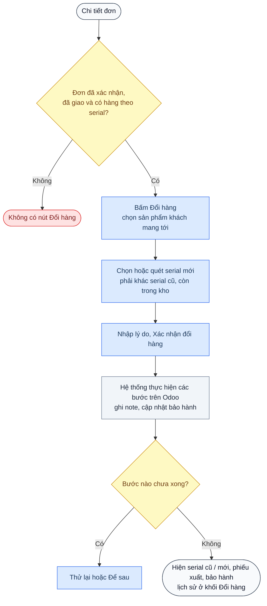

**Ghi chú:** chỉ áp dụng cho sản phẩm theo dõi serial; lịch sử đổi hiện ở khối "Đổi hàng" của chi tiết đơn, kể cả các lần đổi chưa hoàn tất.

---

## A14. Luồng Thu tiền không gắn đơn & "Tiền đã chuyển"

Trang **"Thu tiền"** (menu; điện thoại: More › Thu tiền) dùng khi khách đặt cọc trước khi có đơn, quay lại trả thêm, hoặc để xem số dư khách. Chỉ đọc công nợ, **không có màn thu nợ riêng**: nợ của một đơn thu bằng "Thu tiền" trên đơn đó.

1. Chọn khách. Trang hiện: các đơn cọc / báo giá đang giữ hàng (kèm "Thu thêm", "Đổi ngày lấy"), **số dư khách** (phải thu, tạm ứng khả dụng, đang giữ cho đơn, tổng khách đã gửi) và lịch sử thu tiền.
2. **"Thu tiền mới"**: đặt cọc không gắn đơn (`POST /customer-deposits`) — nhập số cọc, ghi chú, chọn phương thức như A2 (kể cả VietQR với mã phiếu cọc). Tiền này là **tiền khách gửi**, về sau dùng bằng "Dùng tiền cọc" (A2).
3. **"Tiền đã chuyển"** (GH #83): khách đã chuyển khoản nhưng ngân hàng ghi nhận không khớp đơn nào (sai nội dung, chuyển trước khi có mã QR…).
   - Nhân viên nhập đúng **số tiền**, **ngày chuyển**, chọn **tài khoản nhận** của cửa hàng → "Tra cứu". Quá nhiều khoản trùng thì nhập thêm một phần nội dung chuyển khoản. Không liệt kê trước; mỗi lần tra cứu được ghi audit và giới hạn tần suất.
   - Chọn đúng khoản trong kết quả (khoản "vừa về", nghi chuyển nội bộ hoặc đang chờ khớp VietQR thì chưa chọn được) → đính ảnh chứng từ → "Xác nhận".
   - Khoản đó trở thành **tiền cọc của khách** (ghi nhận qua hàng đợi ghi Odoo). **Không hủy được trên POS**; xác nhận nhầm thì kế toán xử lý trên Odoo.

---

---

## Mục lục

### Phần A — Business Flows (Nghiệp vụ)

| # | Luồng | Mô tả |
|---|---|---|
| A1 | Bán hàng — Tạo đơn & Xác nhận | Chọn SP, serial, giảm giá / khuyến mãi, xác nhận hoặc lưu nháp |
| A2 | Nhận thanh toán | Tiền mặt, chuyển khoản, VietQR, COD, dùng tiền cọc; thu nhiều lần, đặt cọc |
| A3 | Xuất kho | Phiếu giao do Odoo tạo, validate khi giao (A9) |
| A4 | Chờ giao & Nháp | Danh sách phiếu giao chưa giao hết, đơn nháp |
| A5 | Hủy đơn hàng | Không có trên giao diện POS; hủy trên Odoo |
| A6 | Xuất hoá đơn điện tử | *(Planned)* Misa chưa có trong code; POS chỉ ghi cờ yêu cầu VAT |
| A7 | Tạo / Cập nhật Khách hàng | Tìm / tạo / sửa `res.partner`, auto-fill MST (escodata, VietQR dự phòng), sync Odoo ngay |
| A8 | Xem Profile Khách hàng | Mở bảng thông tin KH + chương trình khuyến mãi đang áp dụng (Odoo `coupon.program`) |
| A9 | Giao hàng & vào sổ hóa đơn | Chỉ giao khi trả đủ hoặc COD; chọn serial, ảnh giao hàng, hàng đợi ghi Odoo |
| A10 | Đổi ngày hẹn lấy hàng | Dời ngày phiếu giao + ghi note nội bộ |
| A11 | Chuyển cọc | Đổi SP: cọc của đơn đã hủy → công nợ có của khách |
| A12 | Khách ký nhận hàng | Chữ ký khách trên chi tiết đơn, in kèm phiếu |
| A13 | Đổi hàng (đổi serial) | Đổi serial đã giao sang serial khác |
| A14 | Thu tiền: cọc không gắn đơn & Tiền đã chuyển | Trang Thu tiền, số dư khách, xác nhận khoản chuyển không khớp đơn |

### Phần B — Technical Flows (Kỹ thuật)

| # | Luồng | Mô tả |
|---|---|---|
| B1 | Đăng nhập | Microsoft Entra ID, kiểm tra nhóm, kiểm tra vị trí |
| B2 | Làm mới Cache | TTL auto-expire + flush thủ công |
| B3 | Quản lý User | Tự tạo từ Microsoft, ADMIN phân cửa hàng / quyền |
| B4 | Reset Password | *Đã bỏ* (không còn mật khẩu riêng) |
| B5 | Kiểm tra tồn kho | Tra cứu stock.quant theo location |
| B6 | Tra cứu MST | escodata (VietQR dự phòng) + cache Postgres |
| B7 | In phiếu bán hàng | Generate PDF (A4/A5) từ template |
| B8 | Tích hợp Misa (eInvoice) | Xác thực, tạo hoá đơn nháp, xử lý lỗi |
| B9 | Tích hợp Đơn vị giao hàng / COD | Tạo vận đơn, nhận callback xác nhận thu tiền |
| B10 | Tích hợp VNPay API | Payment URL, IPN callback, HMAC-SHA512 |
| B11 | Tích hợp MoMo API | Payment request, IPN callback, HMAC-SHA256 |
| B12 | Tích hợp VietQR Payment | Sinh QR chuyển khoản, xác nhận từ ngân hàng |

---

# Phần A — Business Flows

---

## A1. Luồng Bán hàng — Tạo đơn & Xác nhận

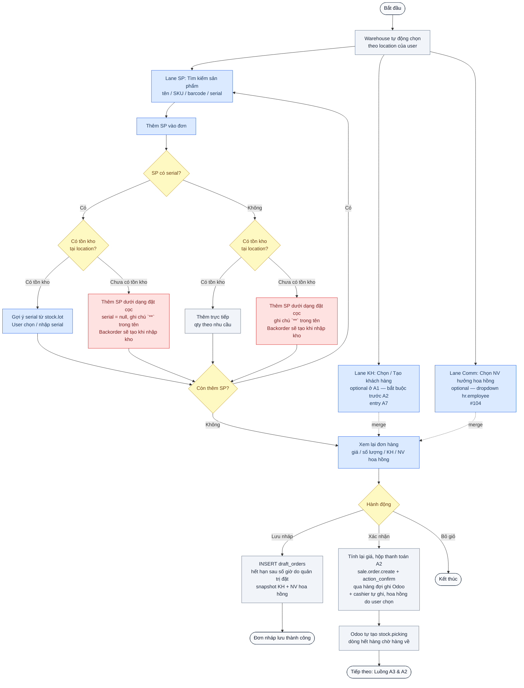

**Ghi chú:**
- **3 lane song song sau B** (clarification 2026-05-19): cashier có thể xen kẽ tự do giữa (1) chọn/tạo KH, (2) chọn NV hưởng hoa hồng, (3) tìm + thêm SP. Không có thứ tự bắt buộc.
  - **Lane KH** — optional ở A1, **bắt buộc trước khi xác nhận** (rule A2; 400 `CUSTOMER_REQUIRED`). Entry: nút "Chọn khách hàng" (F3 trên máy tính). Sub-flow: A7.
  - **Lane Comm** — optional luôn (GH #9, đã làm 2026-09-27). Ô "Hoa hồng" (`CommissionEmployeePicker`, tìm qua `GET /employees/search`, không phân biệt dấu, lọc theo công ty của kho đang bán). Không chọn → `commission_employee` để trống, **không tự điền** thu ngân. Tên thu ngân luôn được ghi tự động dạng text vào `sale.order.origin`.
  - **Lane SP** — vòng lặp `C → D → E → F/G → H → C`; đơn phải có tối thiểu 1 dòng SP. Tìm theo tên / SKU / barcode / serial, quét mã bằng camera (điện thoại, iPad) hoặc máy quét (máy tính, F2).
- **Bước E split 4 nhánh theo combo `có-serial × có-tồn-kho`** (clarification 2026-05-18):

| Có serial? | Tồn kho? | Behavior | Node |
|---|---|---|---|
| Có | ✓ có | Gợi ý từ `stock.lot` → cashier pick 1 serial cụ thể (qty=1/lot) | **F1** |
| Có | ✗ chưa | Thêm vào đơn với `serial_number=null`, tên SP `** ...`, backorder | **F2** |
| Không | ✓ có | Thêm trực tiếp theo qty cashier nhập (qty bất kỳ) | **G1** |
| Không | ✗ chưa | Thêm vào đơn với qty preorder, tên SP `** ...`, backorder | **G2** |

- **Pattern `**` thống nhất** cho mọi dòng "đặt cọc / chờ nhập kho" (F2 và G2) — không phân biệt có serial hay không. Cashier nhìn vào tên SP `**` là biết dòng này sẽ backorder.
- **Serial chỉ chọn, không nhập tay** (owner 2026-09-28, GH #20): dialog chọn serial chỉ liệt kê lot có sẵn; ô tìm chỉ lọc danh sách. Backend từ chối serial không tồn tại / của sản phẩm khác / không còn hàng tại kho bán (409 `SERIAL_NOT_FOUND` / `SERIAL_WRONG_PRODUCT` / `SERIAL_NOT_AVAILABLE`). Cùng một serial hai lần trong một đơn bị chặn (409). Có thể chọn **"Chọn serial sau"** (dòng ghi "Serial: chọn khi giao") — chọn lúc giao hàng.
- **Sau khi xác nhận + thanh toán**: app chuyển thẳng tới chi tiết đơn `/orders/{id}` và hiện banner thành công **một lần** (mã đơn để đọc cho khách, đã thu, còn phải thu, tiền thối). Tải lại trang không hiện lại banner.
- **Kho đang bán được nhớ** theo từng user (GH #17). Đổi kho khi giỏ đang có hàng → giỏ được lưu thành nháp.
- **Giá do Odoo quyết định**: nhân viên không sửa đơn giá (trừ dịch vụ chưa có giá thì nhập giá). Khi bấm "Xác nhận" app tính lại giá theo bảng giá của cửa hàng; giá đổi thì dừng để xem lại tổng mới. Sản phẩm giá giữ chỗ quá thấp bị ẩn khỏi POS.
- **Giảm giá / tăng giá** (nếu quản trị đã bật và cấu hình sản phẩm tương ứng): giảm giá theo số tiền từng dòng, tối đa một tỷ lệ giá trị dòng; "Tăng giá" thêm dòng phụ thu cho cả đơn.
- **Khuyến mãi**: hộp "Khuyến mãi" liệt kê chương trình khách đủ điều kiện, áp tạm tính; **Odoo xác nhận số cuối khi tạo đơn**. Đổi giỏ sau khi áp thì phải áp lại hoặc bỏ.
- **Thông tin thêm** (không bắt buộc): nguồn đơn hàng, nhân viên hoa hồng, người giới thiệu (nếu cửa hàng bật), công tắc "Xuất hoá đơn VAT" + "Xuất hoá đơn cho" (A6).
- **Lưu nháp** (F8 trên máy tính) không cần khách; nháp tự xóa sau một số giờ do quản trị đặt; mở "Tạo đơn" với giỏ trống thì tự mở lại nháp mới nhất của kho; xem / mở lại / xóa mọi nháp ở "Chờ giao & Nháp › Đơn nháp".
- **Serial gán thực tế** ở A3/A9: hàng về kho thì giao ở "Chờ giao" và chọn serial lúc giao. Dòng không serial hết hàng cũng chỉ giao được khi kho đủ.
- **Dòng hết hàng** (F2/G2): cần tích "Chưa có hàng — tạo backorder"; vào giỏ với tiền tố `**`.
- **Chuyển giữa máy / ứng dụng**: giỏ được lưu vào máy khi chuyển app (điện thoại); quá lâu không thao tác thì giỏ tự lưu thành nháp rồi đăng xuất (B1).
- **OQ-K03, OQ-Q04**: cho phép thêm SP hết hàng kèm cảnh báo; serial chọn ngay khi có tồn (F1), defer nếu không (F2, A4).

---

## A2. Luồng Nhận thanh toán

Hộp thanh toán mở khi bấm **"Xác nhận"** ở màn Tạo đơn (đơn **chỉ được tạo trên Odoo khi hoàn tất hộp này**; đóng hộp thì giỏ vẫn còn), hoặc **"Thu tiền"** trên chi tiết một đơn đã có, hoặc "Thu thêm" ở trang Thu tiền.

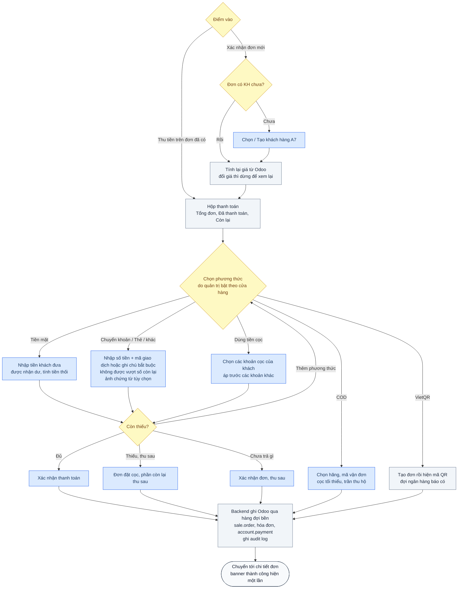

**Ghi chú:**
- **Bắt buộc có KH trước khi xác nhận** (400 `CUSTOMER_REQUIRED`, không tự gán "khách lẻ"). Lưu nháp thì không cần KH.
- **Cửa hàng phải cấu hình đủ** (sổ hóa đơn, tài khoản phân tích, ít nhất một phương thức thanh toán bật có sổ thanh toán) mới bán / thu tiền được; chưa đủ thì "Xác nhận" bị khóa, vẫn "Lưu nháp" được.
- **Phương thức thanh toán cấu hình theo cửa hàng** (GH #26): danh mục dùng chung do quản trị đặt (nhãn, thứ tự, bật/tắt, VietQR); từng cửa hàng bật phương thức nào và chọn sổ thanh toán nào ở "Cấu hình cửa hàng". Không còn gán theo từng user, không còn nút "disabled chờ tích hợp".
- **Tiền mặt** là phương thức duy nhất cho nhận dư (tiền thối). Phương thức khác không được vượt số còn lại; tổng các khoản không vượt giá trị đơn. Có giới hạn "một lần thu tối đa" do quản trị đặt (chặn gõ nhầm).
- **Ảnh chứng từ** (ảnh chuyển khoản, biên lai) không bắt buộc, lưu ngay khi chọn; quản trị có thể bật video.
- **Thu nhiều lần, nhiều phương thức** trong 1 đơn (OQ-C03); đặt cọc nhiều lần (OQ-O01); đơn cọc không hết hạn (OQ-O02). Khách chưa trả đủ → đơn là đơn đặt cọc, thu phần còn lại ở chi tiết đơn ("Thu tiền").
- Nếu mạng / Odoo chậm và chưa rõ kết quả ("Đơn đang được xử lý…"), **không bấm lại**; kiểm tra mục "Thanh toán" của đơn trước khi thu tiếp.

### Chuyển khoản VietQR
- Phương thức nào được quản trị bật VietQR (kèm tài khoản nhận) sẽ sinh **mã QR** gắn với đơn (nội dung chuyển khoản = mã đơn). Tiền được ghi nhận **tự động khi ngân hàng báo có** (webhook); POS **không ghi tay** khoản VietQR.
- Hộp hiện số tiền, nội dung chuyển khoản, ngân hàng, STK, chủ TK; nhân viên chia sẻ / tải mã QR cho khách; FE tự kiểm tra trạng thái ("Đang chờ ngân hàng xác nhận…", có "Kiểm tra ngay").
- **Thu nhiều lần, thiếu, dư**: khách chuyển nhiều lần vào cùng một mã được cộng dồn; chuyển **thiếu** → tạo mã mới cho phần còn lại; chuyển **dư** → phần dư giữ làm tiền cọc của khách.
- Hủy / đóng / tạo lại mã QR; mã có hạn. "Đóng, kiểm tra sau" giữ đơn, tiền về sau tự khớp (chi tiết đơn hiện "Chờ xác nhận VietQR", nút "Mở lại mã QR").
- Sau khi ngân hàng báo có, ghi sổ trên Odoo diễn ra tự động (thường vài phút); không thu lại.
- Có thể kết hợp (vd. tiền mặt một phần + VietQR phần còn lại).
- Khoản khách chuyển mà ngân hàng không khớp được đơn → dùng "Tiền đã chuyển" (A14).

### COD — thu tiền khi giao qua hãng vận chuyển (GH #33/#37/#74)
- Tiền khách trả trước cho cửa hàng là **cọc** (mọi tiền trả trước trong đơn COD đều là cọc). Đơn COD phải có **cọc tối thiểu** tùy giá trị đơn (đơn nhỏ có thể không cần cọc) và hãng chỉ **thu hộ tới một mức trần**; phần vượt phải cọc thêm. Các mức do quản trị đặt, app luôn báo bằng số tiền cụ thể ("Cần cọc thêm …"). Cọc bằng tiền thừa hết đơn thì không cần COD.
- Chọn COD khi tạo đơn: nhập cọc → chọn hãng (mã vận đơn có thể điền sau) → tạo đơn. Hóa đơn cọc ghi cho khách, phần còn lại ghi cho hãng vận chuyển.
- Cọc bằng VietQR: đơn giữ ở dạng **báo giá**, mã QR hiện ngay; khi tiền cọc về, POS **tự xác nhận đơn COD**.
- **Đơn đã xác nhận mà khách còn nợ**: nút **"Giao hàng COD"** trên chi tiết đơn → hóa đơn giữ nguyên, tiền đã nhận là cọc, phần còn lại **chuyển công nợ** từ khách sang hãng bằng một bút toán (cần cọc đạt mức tối thiểu; chưa đủ thì "Thu tiền" thêm trước).
- COD **không hoàn tác** trên POS; chỉ sửa được mã vận đơn. POS không đọc đối soát của hãng.

### Dùng tiền cọc có sẵn của khách
- Khách có tiền cọc (đặt trước ở trang Thu tiền, hoặc phần dư VietQR, hoặc "Tiền đã chuyển") → nút **"Dùng tiền cọc"** trong hộp thanh toán và khối "Tiền cọc khả dụng" ở chi tiết đơn. Chọn các khoản (chỉ một khoản được dùng một phần); cọc được áp **trước**.

### Bản chất hạch toán
- Chế độ vào sổ **khi xác nhận đơn** (mặc định): hóa đơn tạo và vào sổ ngay lúc xác nhận; khoản thu ghi thẳng vào hóa đơn (`account.payment` đối soát với hóa đơn). Kế toán không cần post tay.
- Chế độ **khi đã giao + thu đủ** (cách cũ, GH #2/#7): hóa đơn để nháp; mỗi khoản thu là một `account.payment` độc lập gắn với đơn trong bảng `order_payment_links`, đối soát khi hóa đơn vào sổ (A9).
- "Thu tiền" (đổi tên từ "Thu cọc") có ở chi tiết đơn và ở trang **Thu tiền** (điện thoại: More › Thu tiền) — A14.

---

## A3. Luồng Xuất kho (Auto validate + Serial + Backorder)

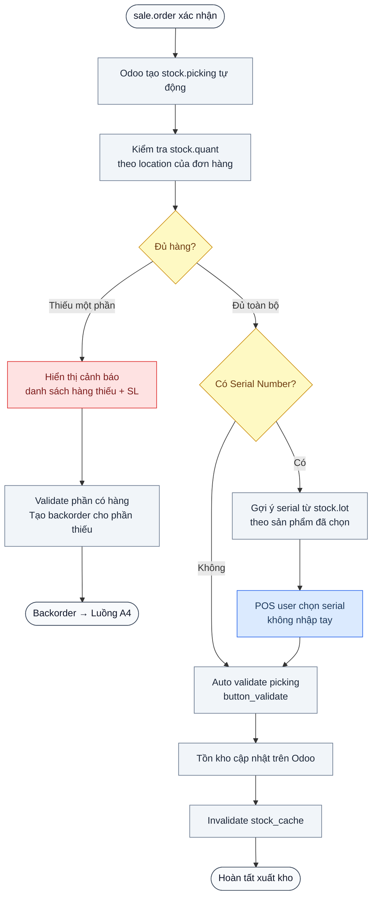

> **Cập nhật 2026-10:** xuất kho **không** tự validate khi xác nhận đơn. Odoo tạo phiếu giao (và giữ hàng nếu đủ tồn); phiếu được validate khi nhân viên bấm **"Giao hàng"** (A9) hoặc làm trực tiếp trên Odoo. Giao hàng chỉ cho khi khách trả đủ hoặc đơn COD. Serial ở bước K chỉ **chọn** từ lot có sẵn trong kho (không nhập tay), chọn lúc giao nếu khi bán chưa chọn. Lệnh giao chạy qua hàng đợi ghi Odoo.

---

## A4. Luồng Chờ giao & Nháp (trước đây: Quản lý Backorder)

Trang **"Chờ giao & Nháp"** (GH #97) gộp "Backorder" và "Chờ giao" cũ; đường dẫn `/backorders` tự chuyển sang `/deliveries`. Có hai tab: **Chờ giao** và **Đơn nháp** (A1).

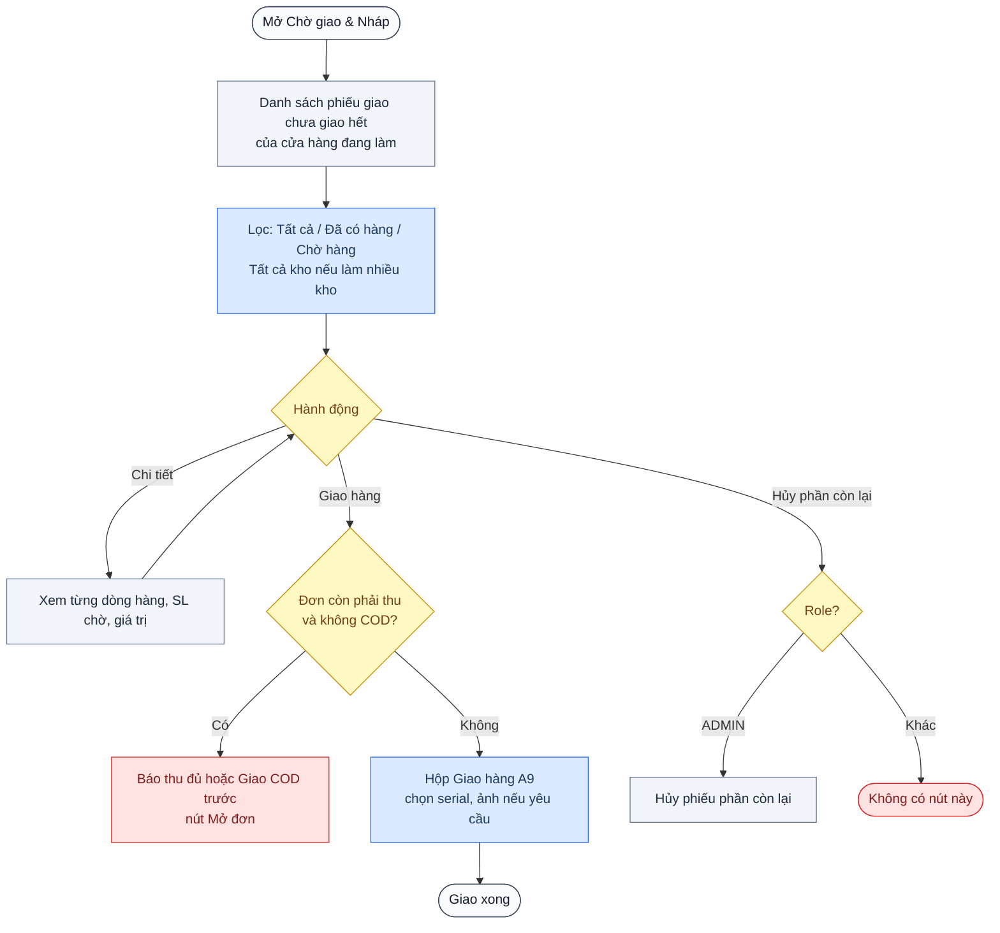

**Ghi chú:**
- Phiếu "chờ hàng": kho chưa đủ hàng (gồm dòng đặt trước `**` tạo ở A1); có hàng về thì phiếu thành "đã có hàng", giao được.
- Mỗi dòng: mã đơn / phiếu, khách và sản phẩm, cửa hàng, ngày hẹn giao, SL chờ, giá trị, trạng thái. Đơn của nhân viên khác hiện "Đơn của NV khác" thay giá.
- Trang tự tải lại định kỳ, có nút "Tải lại".
- Hủy phần còn lại chỉ dành cho ADMIN.

---

## A5. Luồng Hủy đơn hàng

**POS không có chức năng hủy đơn trên giao diện** (issue #51): không có nút "Hủy đơn" cho nhân viên lẫn quản lý cửa hàng. Việc hủy đơn thực hiện **trên Odoo** (sale.order → Hủy); hủy đơn nháp trong POS chỉ là "Xóa" / "Bỏ nháp" (A1).

Backend có sẵn `POST /orders/{id}/cancel` **chỉ dành cho ADMIN** (GH #115) nhưng giao diện chưa gọi. Khi được gọi, các quy tắc chặn:
- Đơn đã có hóa đơn khách hàng vào sổ → từ chối (`ORDER_CANCEL_HAS_INVOICE`), kế toán xử lý trên Odoo.
- Đơn đang giữ tiền khách chưa vào hóa đơn (thu trước, cọc, VietQR đã báo có chưa ghi) → từ chối (`ORDER_CANCEL_HAS_PAYMENT`).
- Đơn đã giao hàng → từ chối (`ORDER_CANCEL_DELIVERED`).
- Hóa đơn nháp đơn thuần không chặn; hủy cùng đơn.

Sau khi hủy trên Odoo, nếu đơn còn tiền cọc thì dùng **"Chuyển cọc"** (A11). Hoàn tiền cọc cho khách làm trên Odoo.

---

## A6. Luồng Xuất hoá đơn điện tử (Misa) *(Planned — chưa có trong code)*

> **Trạng thái code (2026-10-29):** chưa tích hợp Misa. Hiện POS chỉ cho nhân viên bật "Xuất hoá đơn VAT" khi tạo đơn hoặc "Sửa thông tin" đơn, chọn "Xuất hoá đơn cho" (khách hoặc một công ty có MST), và ghi cờ yêu cầu này lên đơn Odoo; kế toán xuất hóa đơn điện tử ngoài POS. Hóa đơn bán hàng trên Odoo do POS tạo theo A9. Sơ đồ dưới là thiết kế dự kiến.

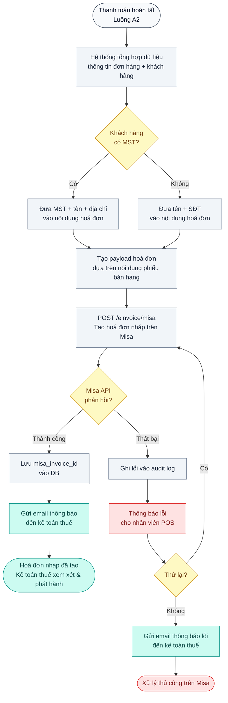

**Ghi chú:**
- Hoá đơn chỉ được tạo ở trạng thái **nháp** — kế toán thuế phát hành chính thức trên Misa
- Nội dung hoá đơn dựa trên phiếu bán hàng (A8 / B7): danh sách sản phẩm, số lượng, đơn giá, tổng tiền
- Email thông báo gửi đến địa chỉ kế toán thuế được cấu hình trong hệ thống
- Nếu Misa API thất bại: audit log lưu lại để xử lý thủ công, không ảnh hưởng đến đơn hàng

---

## A7. Luồng Tạo / Cập nhật Khách hàng

Luồng quản lý `res.partner` — cả POS User và ADMIN đều được phép **tạo** và **cập nhật** (per OQ-J04, OQ-AE03). Entry points: từ màn Tạo đơn hàng (bấm "Chọn khách hàng"), hoặc từ Dialog Thanh toán (nếu chưa có KH), hoặc từ admin CRUD trong tương lai.

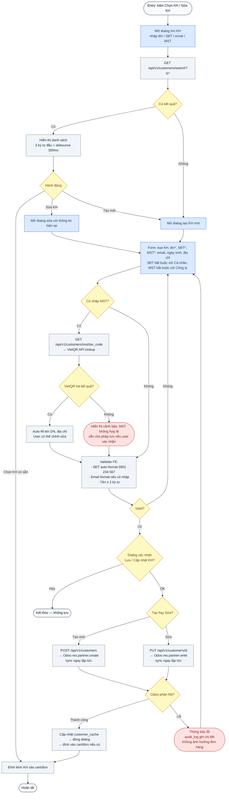

**Ghi chú:**

- **Quyền**: cả POS User và ADMIN đều được tạo / sửa — per OQ-J04, OQ-AE03.
- **Loại khách**: "Cá nhân" hoặc "Công ty". Bắt buộc: `tên` (từ 2 ký tự); **SĐT bắt buộc với Cá nhân** (tùy chọn với Công ty); **MST bắt buộc với Công ty** (10 hoặc 13 số). **Email tùy chọn** (Công ty: "Email nhận hóa đơn"). Ngày sinh (chỉ Cá nhân) và địa chỉ tùy chọn. (Thay đổi so với OQ-J02 ban đầu, GH #56 / #85.)
- **MST đã tồn tại**: tạo Công ty trùng MST với một công ty đã có → 409 `CUSTOMER_MST_EXISTS`, gợi ý chọn công ty đó.
- **Tìm kiếm** (OQ-J03): tên, SĐT, email, MST từ 3 ký tự; khi chưa gõ có mục "Xem gần đây". Khách bị quản trị ẩn khỏi POS sẽ không hiện.
- **SĐT auto-format** (OQ-AF02): `0901234567` → `0901 234 567`. Regex VN: `^(0|\+84)(\d{9,10})$`.
- **Tra MST** (OQ-X01, B6): nút "Tra MST" → escodata mặc định, VietQR dự phòng → auto-fill tên + địa chỉ, sửa được; báo lỗi nếu MST không còn hoạt động.
- **Sync ngay** (OQ-X01): backend gọi `res.partner.create` / `write` qua JSON-RPC ngay khi bấm Lưu; cache khách được làm mới.
- **Confirm dialog** (OQ-Q01): xác nhận trước khi tạo / cập nhật.
- **Đính kèm vào cart**: entry từ màn Tạo đơn → sau khi lưu, khách được chọn cho đơn luôn.
- **Mục "Khách hàng" trên menu**: mở hộp "Tìm khách hàng" để tra cứu / xem profile (A8) / sửa, **không ảnh hưởng giỏ hàng**.
- **Nhãn công nợ** trên khách đã chọn: "Đang nợ …", "Còn dư …" hoặc "Không có công nợ".
- **Error handling**: Odoo fail → giữ dialog mở, hiện lỗi, audit_log ghi lại; retry hoặc hủy.
- **Không cho xóa KH**: ngoài phạm vi (chỉnh trên Odoo nếu cần).

---

## A8. Luồng Xem Profile Khách hàng

Nhân viên mở "Profile khách hàng" để xem nhanh thông tin KH và **các chương trình khuyến mãi đang áp dụng** cho KH đó. Chỉ đọc (read-only) — không áp discount vào đơn.

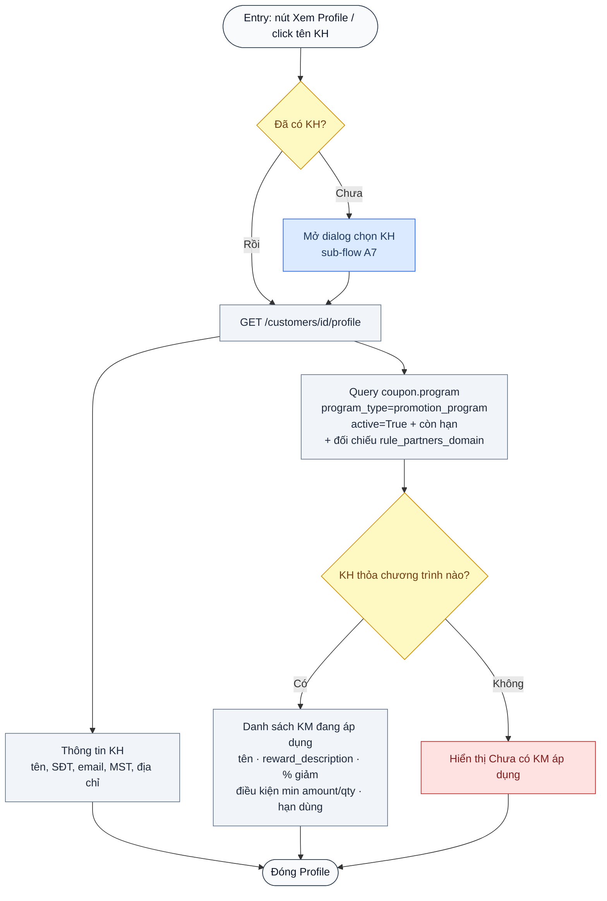

**Ghi chú:**
- **Nguồn dữ liệu:** Odoo 14 CE `coupon.program` (module `coupon` + `sale_coupon`). Odoo 14 **không** có `loyalty.program` (Odoo 16+).
- **KM "đang áp dụng":** `program_type='promotion_program'` (KM tự động — khác `coupon_program` cần nhập mã) + `active=True` + `now ∈ [rule_date_from, rule_date_to]` + KH thỏa `rule_partners_domain`.
- **`rule_partners_domain` là chuỗi domain** (không phải Many2one) → với mỗi chương trình active, kiểm tra KH có match không bằng `search_count("res.partner", eval(rule_partners_domain) + [("id","=",customer_id)]) > 0`.
- **Read-only:** chỉ hiển thị để nhân viên tư vấn KH — **không** tự áp discount vào `sale.order` (áp discount vẫn ngoài phạm vi — B-03).
- **Entry points:** nút "Xem Profile" trên cart panel (`CustomerButton`) / trong dialog chọn KH (A7) / màn chi tiết đơn. Ngoài ra mục **"Khách hàng"** (điện thoại: More → Khách hàng; iPad: tab "Khách hàng"; máy tính: sidebar) mở ô tìm khách hàng để xem profile.
- Chi tiết kỹ thuật + endpoint đề xuất: [issue #115](../planning/issue_log_staging_dev.md).

**Đã làm (GH #10, 2026-09-27) — endpoint `GET /customers/{id}/profile` ([api_contract §3.5](../planning/02.%20api_contract.md)):**
- Ngoài `promotion_program` còn hiện **coupon riêng** của KH (`coupon.coupon`, trạng thái `new`/`sent`, chưa hết hạn). **Mã coupon riêng bị che ngay trong API** (chỉ còn 4 ký tự cuối, ví dụ `••••4267`); mã chung của chương trình vẫn hiện đầy đủ, có nút copy.
- **Lọc theo công ty** của kho / location đang bán (hoặc chương trình dùng chung).
- **Tag theo giỏ hàng:** API trả điều kiện có cấu trúc (`min_amount`, `min_qty`, `product_scope`); FE so với tổng giỏ để hiện "Đủ điều kiện" hoặc "Còn thiếu X ₫".
- Chương trình có `rule_partners_domain` không đánh giá được ngoài Odoo → vẫn hiện, đánh dấu `unverified`. Chương trình hết lượt (`maximum_use_number`) bị loại.
- Thông tin KH có thêm **Bảng giá** (`property_product_pricelist`).
- Vẫn **chỉ đọc**: không áp khuyến mãi vào đơn.

---

## A9. Luồng Giao hàng & vào sổ hóa đơn

Nguyên tắc (owner 2026-10-13): **chỉ giao hàng khi khách đã trả đủ 100% hoặc đơn là COD** (đơn còn nợ bị từ chối `ORDER_NOT_PAID`). API: `POST /orders/{id}/deliver` và `POST /deliveries/{picking}/deliver` (một dòng của trang "Chờ giao"), cùng chạy một logic ([api_contract §5.5](../planning/02.%20api_contract.md)).

Thời điểm hóa đơn vào sổ do quản trị chọn (`Cấu hình hệ thống › Hóa đơn`):
- **Khi xác nhận đơn** (mặc định hiện nay): hóa đơn tạo và vào sổ ngay khi xác nhận, ngày hóa đơn = ngày xác nhận, mọi khoản thu ghi thẳng vào hóa đơn. Giao hàng chỉ validate phiếu giao.
- **Khi đã giao + thu đủ** (cách cũ, chỉ đổi khi kế toán yêu cầu): hóa đơn để nháp từ lúc xác nhận, vào sổ khi đơn đã giao và đã thu đủ, ngày hóa đơn = ngày giao (GH #2, #7).

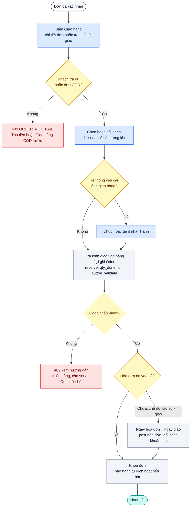

**Ghi chú:**
- Lệnh giao chạy qua **hàng đợi ghi Odoo** bền (GH #80): nếu Odoo trả lời chậm, API trả 202 "đang xử lý"; hộp giao hàng cho phép đóng, kết quả báo lại trên chi tiết đơn (dải "Giao hàng chưa thành công" nếu thất bại). Lệnh được thử lại khi Odoo gián đoạn.
- **Serial**: dòng bán theo serial mà chưa có serial thì bắt buộc chọn lúc giao (chọn từ kho, không nhập tay); có thể đổi serial đã bán sang serial khác còn trong kho.
- **Ảnh giao hàng** (GH #53): khi hệ thống yêu cầu, phải có ít nhất 1 ảnh mới giao được (`DELIVERY_PHOTO_REQUIRED`).
- **Giao từng phần**: phần còn lại thành phiếu giao mới ở "Chờ giao" với nhãn "Giao tiếp · đã giao một phần"; chỉ ADMIN được "Hủy phần còn lại".
- **Đơn của nhân viên khác** vẫn giao được phục vụ khách (GH #58) nhưng ẩn giá.
- Phiếu đã validate trên Odoo được bỏ qua; nút "Giao hàng" vẫn dùng được để vào sổ hóa đơn cho đơn đã giao trên Odoo khi chế độ vào sổ khi giao. Job nền định kỳ quét đơn giao thẳng trên Odoo.
- Lỗi Odoo trả 409 có mã (`STOCK_NOT_RESERVED`, `SERIAL_REQUIRED`, `SERIAL_NOT_FOUND`, `SERIAL_WRONG_PRODUCT`, `PICKING_NEEDS_ODOO_ACTION`, `DELIVERY_REJECTED` kèm nguyên văn lỗi Odoo cho quản lý / kế toán, `ORDER_NOT_PAID`, `DELIVERY_PHOTO_REQUIRED`).
- "In phiếu giao": **không làm** (owner 2026-09-28, #18); Phiếu xác nhận đơn (đã giao đủ hàng) đóng vai trò phiếu giao kiêm bảo hành (B7).
- **Giao hàng COD** (đơn đã xác nhận, khách còn nợ): xem A2 mục COD.

---

## A10. Luồng Đổi ngày hẹn lấy hàng (TH4 / TH5)

Khách đến sớm hơn hoặc muộn hơn ngày hẹn. API: `PATCH /orders/{id}/pickup-date` ([api_contract §5.7](../planning/02.%20api_contract.md)).

- **Ngày hẹn lấy hàng = `scheduled_date` của phiếu giao đi đang chờ** (sớm nhất nếu có nhiều phiếu). Chi tiết đơn hiện ở thẻ "Hẹn lấy hàng", danh sách đơn có cột / trường `pickup_date`.
- Nhân viên bấm **"Đổi ngày"**, chọn ngày mới (từ hôm nay tới số ngày tối đa do quản trị đặt), nhập lý do (không bắt buộc).
- Backend dời `scheduled_date` của mọi phiếu giao đang chờ (giữ giờ trong ngày theo giờ VN) và `date_deadline` của các move chưa xong, rồi ghi **note nội bộ** lên chatter đơn: `[POS] Đổi ngày hẹn lấy hàng: cũ → mới. Lý do: …. Người đổi: …`.
- **POS không sửa, không đóng `mail.activity`** (owner 2026-09-28: "không động tới activity nữa, chỉ dời ngày phiếu giao và ghi note"). Endpoint sửa activity của bản đầu (`PATCH /orders/{id}/activities/{id}`) **đã bỏ**.
- Không đổi `commitment_date` (chỉ hiển thị).

---

## A11. Luồng Chuyển cọc (đổi sản phẩm — TH6)

API: `POST /orders/{id}/release-deposit` ([api_contract §5.6](../planning/02.%20api_contract.md)). GH #5, kế toán chốt ở GH #15.

1. **Hủy đơn cũ trên Odoo** (báo giá + phiếu giao + hoạt động cần làm; Odoo hỏi hủy hóa đơn nháp thì xác nhận). POS không có nút hủy đơn trên giao diện (#51).
2. Trên chi tiết đơn cũ (đã hủy, còn cọc) bấm **"Chuyển cọc"**, chọn đơn mới của cùng khách (không bắt buộc).
3. Backend bỏ liên kết giữ cọc (`order_payment_links` → `released`). `account.payment` giữ nguyên, trở thành **công nợ có của khách** (xem ở "Tiền cọc của khách"). Nếu có đơn mới → trừ luôn vào đơn mới (như `apply-credit`).
4. Chặn khi: đơn cũ chưa hủy, đã giao hàng, hóa đơn đã vào sổ đang giữ cọc (kế toán "Đặt lại về nháp" + "Hủy" hóa đơn trước), hoặc không có cọc đang giữ trên POS.

**Hoàn tiền cọc (TH7 — khách hủy cọc):** kế toán hoàn thủ công trên Odoo. POS không có chức năng hoàn tiền.

---

# Phần B — Technical Flows

---

## B1. Luồng Đăng nhập (Authentication)

Đăng nhập **chỉ bằng tài khoản Microsoft (Entra ID)** của công ty. Không có username / mật khẩu riêng trong POS.

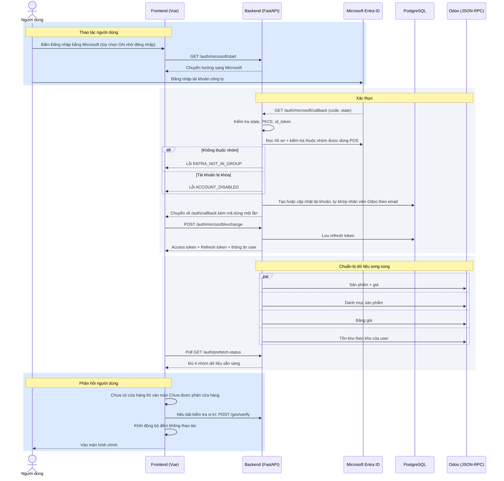

**Ghi chú:**
- Quyền dùng POS và quyền ADMIN lấy từ **nhóm trên Microsoft Entra**; thông tin cá nhân lấy từ Microsoft 365. Không có mật khẩu, không có khóa tài khoản theo số lần nhập sai trong POS.
- Ô "Ghi nhớ đăng nhập trên máy này": tích thì phiên lưu lâu hơn, bỏ tích thì mất khi đóng trình duyệt. Phiên được làm mới bằng refresh token; quản trị khóa tài khoản hoặc bớt khỏi nhóm thì lần làm mới sau bị từ chối và app đưa về trang đăng nhập kèm lý do.
- Không để token trong URL: callback chỉ mang mã dùng một lần, đổi lấy token qua POST.
- Không hoạt động trong một thời gian dài → hộp đếm ngược 60 giây → tự lưu giỏ thành đơn nháp rồi đăng xuất (OQ-M03; thời lượng do hệ thống đặt).
- Chuẩn bị dữ liệu chạy song song ngay sau đăng nhập; FE hiện tiến độ "N/4 nhóm dữ liệu" và chỉ cho vào màn chính khi đủ 4 nhóm (sản phẩm + giá, danh mục, bảng giá, tồn kho). Hết thời gian chờ thì báo liên hệ quản trị và có nút "Thử lại".
- Nhân viên nhiều kho: chọn kho làm việc; kho được nhớ cho lần sau (GH #17).
- **Kiểm tra vị trí (GPS)**: nếu quản trị bật, nhân viên phải ở trong phạm vi cửa hàng mới dùng được chức năng bán hàng. Vị trí chỉ dùng để kiểm tra, không lưu. Quản trị có thể miễn cho từng nhân viên (giao hàng, bán sự kiện); cửa hàng chưa có tọa độ thì không bị kiểm.

---

## B2. Luồng Làm mới Cache

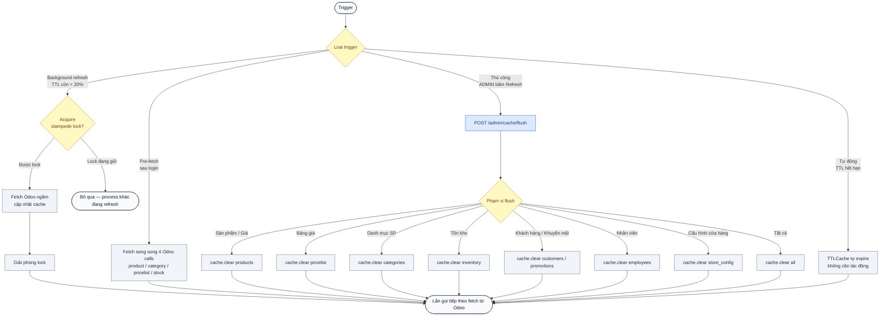

**TTL:** mỗi nhóm cache có thời gian sống riêng (từ vài phút tới vài giờ) do hệ thống đặt; trang quản lý cache hiển thị cột TTL, số key, dung lượng và thời điểm làm mới của từng nhóm.

---

## B3. Luồng Quản lý User (ADMIN)

Tài khoản POS được tạo **tự động** khi người dùng đăng nhập Microsoft lần đầu (hoặc tạo sẵn bằng nút "Đồng bộ từ nhóm"). ADMIN không nhập username / mật khẩu nữa mà **phân quyền** cho tài khoản đã có.

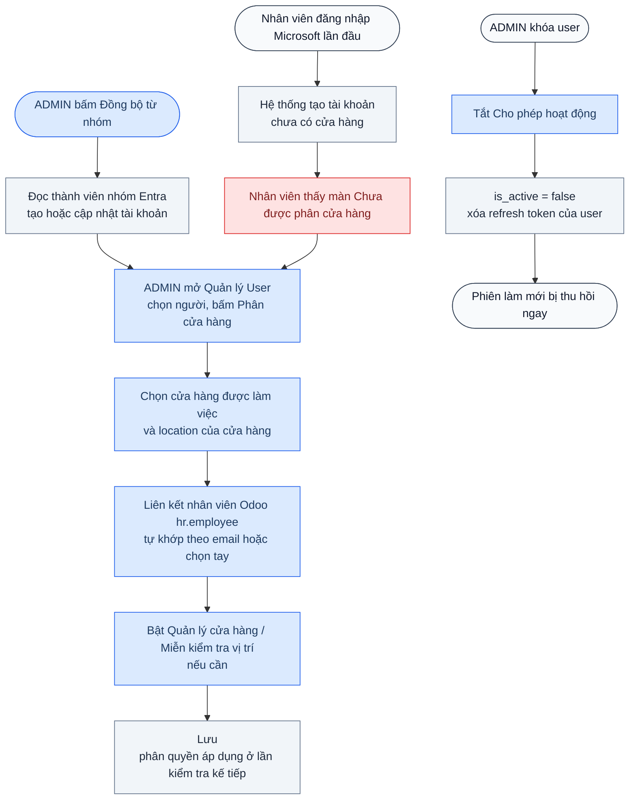

**Ghi chú:**
- Vai trò **ADMIN** do nhóm admin trên Microsoft Entra quyết định, không cấp trong POS.
- Thông tin cá nhân (tên, email, chức danh, phòng ban, điện thoại, ảnh) lấy từ Microsoft 365, chỉ xem.
- 1 nhân viên Odoo chỉ liên kết với 1 tài khoản; liên kết dùng cho hoa hồng / báo cáo.
- **Quản lý cửa hàng**: thấy đơn của mọi người ở cửa hàng; nhân viên thường chỉ thấy đơn mình tạo (đơn của đồng nghiệp chỉ hiện ở "Chờ giao" để giao hàng, ẩn giá). ADMIN thấy tất cả.
- Tài khoản cũ (trước khi chuyển sang Microsoft) hiển thị dạng chỉ-đọc, chỉ bật / tắt được trạng thái.
- Khóa user → thu hồi phiên làm mới ngay (OQ-M02).

---

## B4. Luồng Reset Password — *đã bỏ*

Hệ thống không còn mật khẩu riêng (xem B1), nên không còn "Quên mật khẩu?", không còn email reset và không còn thao tác "Reset Password" của ADMIN. Mật khẩu, khóa tài khoản theo số lần nhập sai và đổi mật khẩu đều do tài khoản Microsoft (Office 365) của công ty quản lý; người dùng cần đặt lại mật khẩu thì dùng quy trình của Microsoft / bộ phận quản trị Microsoft 365.

Endpoint đăng nhập bằng mật khẩu cũ trả về 410 (đã gỡ).

---

## B5. Luồng Kiểm tra tồn kho

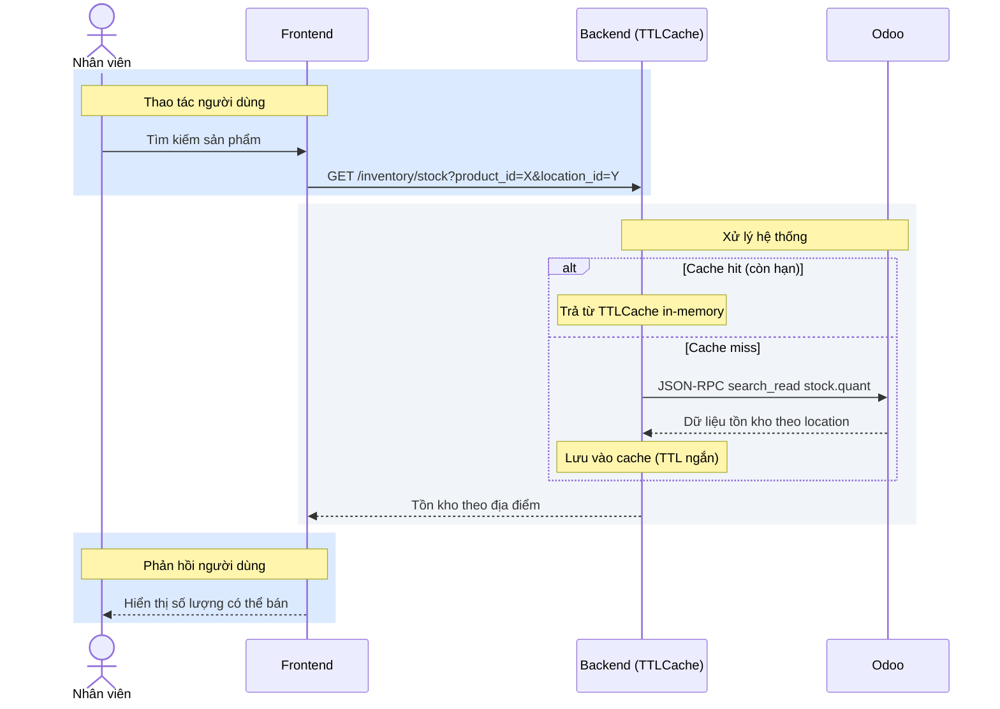

---

## B6. Luồng Tra cứu MST

```mermaid
sequenceDiagram
    actor User as Thu ngân
    participant FE as Frontend
    participant BE as Backend (pg_cache)
    participant MST as escodata (VietQR dự phòng)

    rect rgb(219, 234, 254)
        Note over User,FE: Thao tác người dùng
        User->>FE: Nhập mã số thuế
        FE->>BE: GET /customers/mst/{tax_code}
    end
    rect rgb(241, 245, 249)
        Note over BE,MST: Xử lý hệ thống
        alt Cache hit (tìm thấy: lưu tạm; không tìm thấy: lưu rất ngắn)
            Note over BE: Trả từ cache Postgres (pg_cache)
        else Cache miss
            BE->>MST: GET escodata /api-mst/{tax_code}.htm
            alt escodata lỗi mạng / 5xx (sau 3 lần thử)
                BE->>MST: Dự phòng: VietQR GET /v2/business/{tax_code}
            end
            MST-->>BE: Tên, địa chỉ, trạng thái hoạt động
            Note over BE: Lưu cache. Lỗi không cache
        end
        BE-->>FE: Thông tin doanh nghiệp
    end
    rect rgb(219, 234, 254)
        Note over FE,User: Phản hồi người dùng
        FE-->>User: Auto-fill form khách hàng
    end
```

---

## B7. Luồng In phiếu bán hàng (Generate PDF)

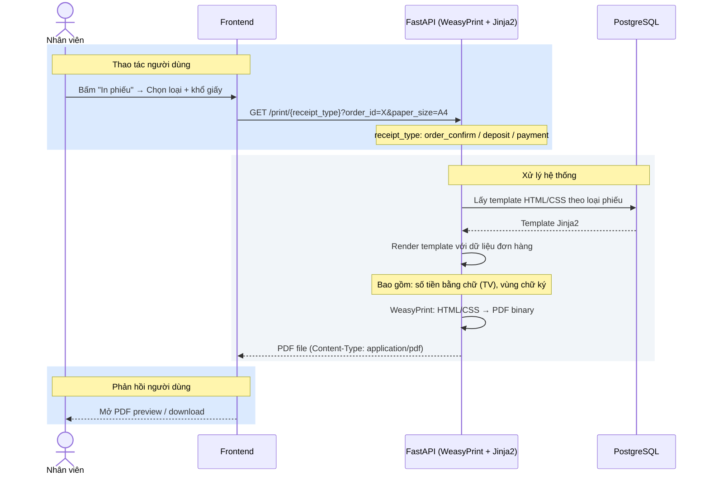

**Ghi chú:**
- Khổ giấy: A4, A5 hoặc K80 (giấy cuộn 80 mm). Khổ mặc định chọn ở `Cài đặt › In`, lưu theo từng máy / trình duyệt.
- Điều kiện in theo tình trạng đơn: Phiếu xác nhận đơn chỉ khi đã giao đủ hàng; Phiếu đặt cọc khi chưa giao đủ và đã có thanh toán; Phiếu thanh toán khi đã có ít nhất một khoản thanh toán.
- Mỗi phiếu có mã QR dẫn tới trang đơn trong POS (để quét mở lại đơn), không phải mã thanh toán. Phiếu in kèm chữ ký khách nếu có (A12).
- Chỉ preview / download, không in trực tiếp (OQ-U02). Mẫu phiếu do quản trị chỉnh trong trang quản lý template.

---

## B8. Tích hợp Misa (eInvoice) *(Planned)*
> **Trạng thái code (2026-10-29):** chưa có trong code (không có tích hợp Misa). POS chỉ ghi nhận "khách yêu cầu xuất hóa đơn VAT" và "xuất hóa đơn cho" (khách hoặc công ty) trên đơn để kế toán xử lý — xem A6.

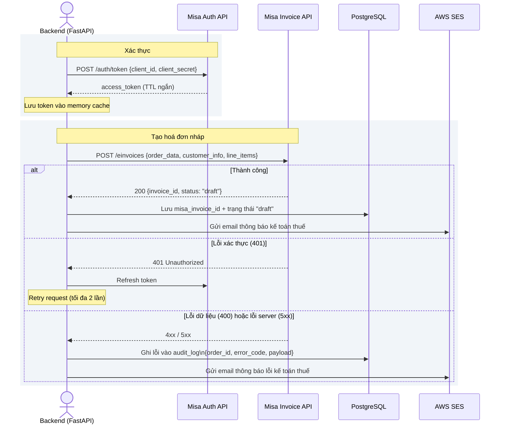

**Ghi chú:**
- Access token Misa lưu cache in-memory, tự refresh khi hết hạn
- Payload hoá đơn dựa trên nội dung phiếu bán hàng (B7): danh sách SP, số lượng, đơn giá, thuế
- Hoá đơn tạo ở trạng thái `draft` — kế toán phát hành chính thức trên portal Misa
- Mọi lỗi đều ghi `audit_log` để xử lý thủ công, không ảnh hưởng đến đơn hàng
- Cần bổ sung: `client_id`, `client_secret`, `company_tax_code` vào config

---

## B9. Tích hợp Đơn vị giao hàng / COD *(Planned)*
> **Trạng thái code (2026-10-29):** chưa tích hợp API hãng vận chuyển (không tạo vận đơn qua API, không nhận callback thu tiền). Phần đã làm theo cách thủ công: thu tiền hộ qua hãng giao hàng được ghi nhận trong POS (hãng, mã vận đơn nhập tay, cọc tối thiểu, trần thu hộ), phần còn lại chuyển công nợ sang hãng — xem A2 mục COD và A9. POS không đọc đối soát của hãng; việc đó kế toán làm trên Odoo.

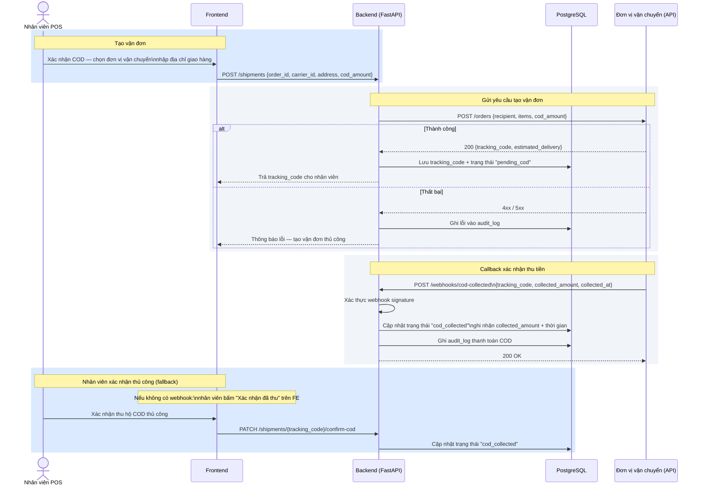

**Ghi chú:**
- Hỗ trợ nhiều đơn vị vận chuyển — cấu hình `carrier_id` và endpoint riêng cho từng đơn vị
- Webhook signature cần xác thực bằng HMAC trước khi xử lý
- Fallback thủ công khi đơn vị vận chuyển không hỗ trợ webhook
- Trạng thái COD: `pending_cod` → `cod_collected` → phản ánh vào luồng thanh toán A2
- Cần bổ sung: danh sách đơn vị vận chuyển tích hợp, cơ chế đối soát định kỳ

---

## B10. Tích hợp VNPay API *(Planned)*
> **Trạng thái code (2026-10-29):** chưa có trong code (không có tích hợp VNPay).

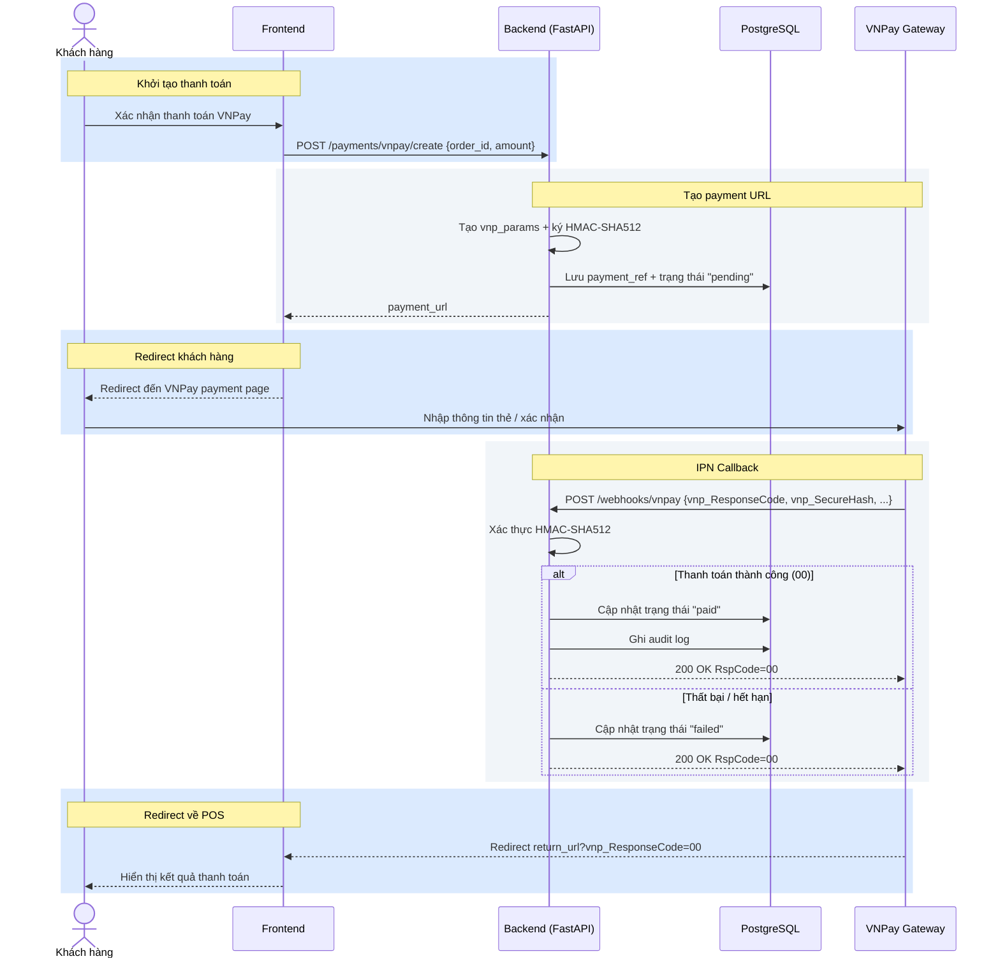

**Ghi chú:**
- Backend phải trả `200 OK` cho VNPay IPN dù thành công hay thất bại — nếu không VNPay sẽ retry
- Xác thực `vnp_SecureHash` bắt buộc trước khi xử lý bất kỳ callback nào
- `return_url` chỉ để hiển thị kết quả cho user — không dùng để cập nhật trạng thái (dùng IPN)

---

## B11. Tích hợp MoMo API *(Planned)*
> **Trạng thái code (2026-10-29):** chưa có trong code (không có tích hợp MoMo).

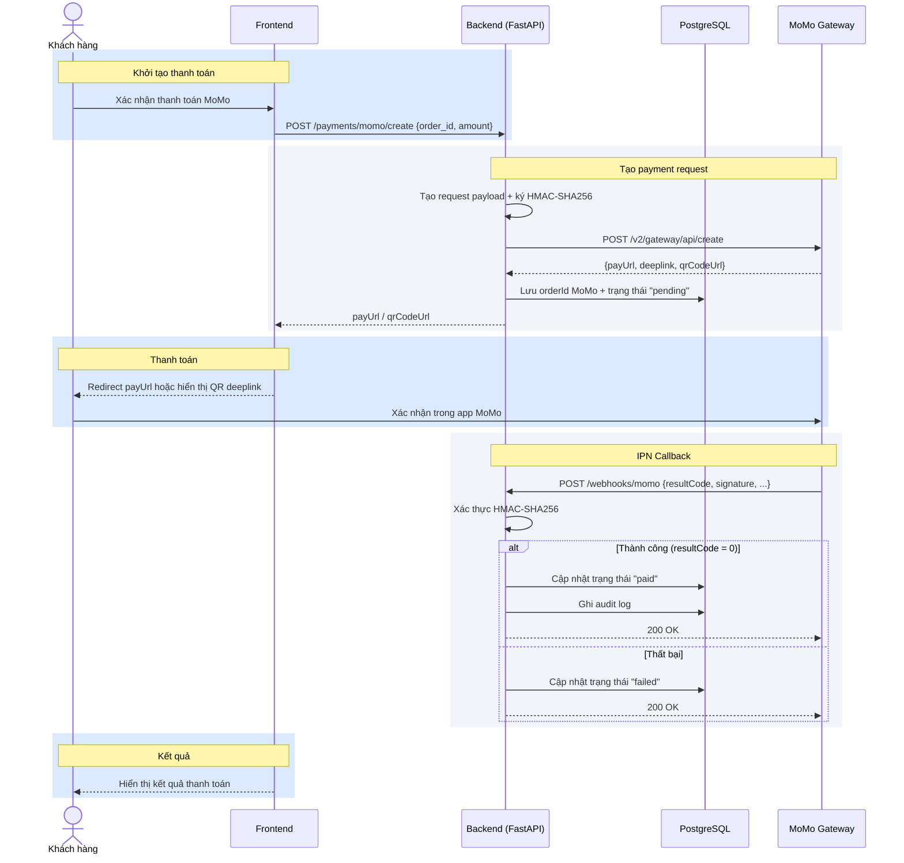

**Ghi chú:**
- Hỗ trợ 2 luồng: redirect (`payUrl`) trên desktop, QR deeplink trên mobile
- `resultCode = 0` là thành công; các mã khác là lỗi — xem tài liệu MoMo
- Xác thực signature bắt buộc trước khi xử lý IPN

---

## B12. Tích hợp VietQR Payment *(Đã làm một phần)*
> **Trạng thái code (2026-10-29):** phần **sinh mã QR VietQR cho đơn hàng và phiếu cọc, nhận báo có từ ngân hàng, tự ghi nhận thanh toán** đã làm — xem A2 mục "Chuyển khoản VietQR". Sơ đồ bên dưới là thiết kế ban đầu; khác biệt thực tế: tiền được xác nhận nhờ dịch vụ báo biến động số dư ngân hàng gọi webhook (có chữ ký) về hệ thống; hệ thống đối chiếu theo nội dung chuyển khoản (mã đơn / mã phiếu cọc) và số tiền, cho phép khách chuyển nhiều lần, thiếu hoặc dư. Không có cơ chế "ghi tay" cho phương thức VietQR.

> **Lưu ý phân biệt**: Luồng này là VietQR **thanh toán** (sinh QR chuyển khoản ngân hàng) — khác hoàn toàn với VietQR MST lookup (B6) dùng để tra cứu mã số thuế.

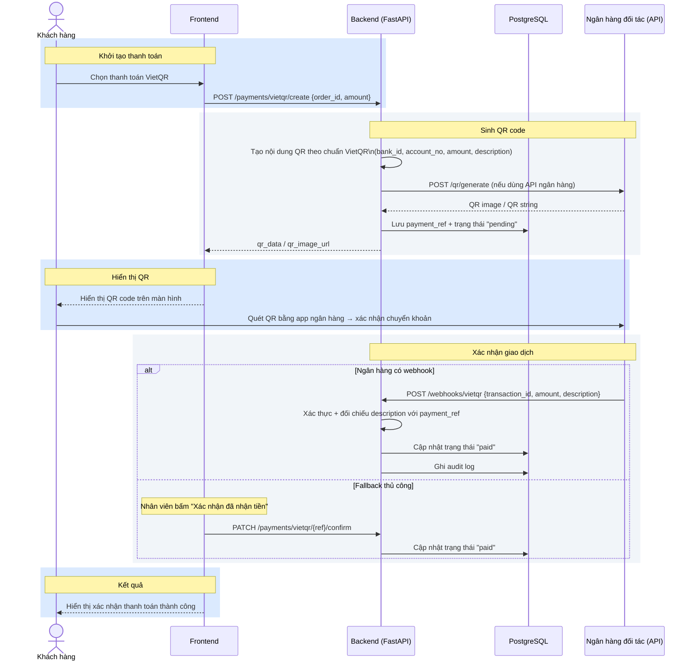

**Ghi chú:**
- QR chuẩn VietQR có thể sinh tĩnh (không cần API ngân hàng) nếu chỉ cần nhúng số tài khoản + số tiền
- Cơ chế xác nhận phụ thuộc vào ngân hàng đối tác — không phải ngân hàng nào cũng có webhook
- `description` (nội dung chuyển khoản) dùng để đối chiếu tự động — cần format chuẩn (vd: mã đơn hàng)
- Fallback thủ công là bắt buộc khi webhook không khả dụng

---

## Tham chiếu

| Tài liệu | Mô tả |
|---|---|
| [scope.md](scope.md) | Scope & Architecture |
| [api_contract.md](api_contract.md) | API Contract (40 endpoints) |
| [frontend_design.md](frontend_design.md) | Thiết kế giao diện |
| [open_questions.md](open_questions.md) | Câu hỏi đã xác nhận |
